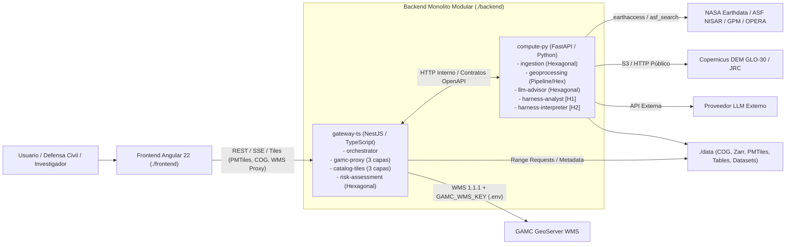

# 01 · Arquitectura General y Decisiones de Diseño

## 1. Visión Arquitectónica

El sistema adopta un **Monolito Modular Políglota** en `./backend` acompañado de una **SPA en Angular 22** en `./frontend`, todo contenido en un único monorepo y orquestable mediante **Docker Compose**.

---

## 2. Decisiones Tecnológicas y Trade-offs

| Decisión | Alternativa Evaluada | Por qué elegimos esta opción | Trade-off aceptado |
| :--- | :--- | :--- | :--- |
| **Monorepo + Monolito Modular Políglota** (`gateway-ts` + `compute-py`) | Microservicios distribuidos con broker (Kafka/RabbitMQ) | En una hackathon, mantener 5+ repos y un broker de mensajería consume horas valiosas de DevOps. Un monolito modular da aislamiento lógico (módulos desacoplados por contratos) con despliegue simple en 2 procesos dentro de Docker Compose. | Dos runtimes en backend (`Node 22` y `Python 3.10+`), mitigado mediante contratos OpenAPI/JSON Schema en `backend/shared/`. |
| **NestJS (TS) como Gateway/Dominio de Producto + FastAPI (Py) como Motor Científico/IA** | Todo en Python (solo FastAPI) o todo en Node | Python es insustituible para HDF5/NISAR, `xarray`, `rioxarray`, `zarr`, GDAL y agentes LLM. NestJS aporta tipado estricto de contratos web, inyección de dependencias SOLID, proxy WMS seguro y separación limpia respecto al cálculo pesado. | Comunicación inter-proceso HTTP local (`gateway-ts` -> `compute-py`), que mantiene baja latencia si comparten red Docker o volumen `./data`. |
| **Pipeline `COG` + `Zarr` + `PMTiles`** | Servir PNGs pre-renderizados o leer HDF5 en tiempo real | **COG** permite lectura parcial por *HTTP Range* y visualización de alta resolución; **Zarr** habilita cubos `(time, y, x)` instantáneos para series de tiempo por píxel y animaciones; **PMTiles** entrega capas vectoriales/riesgo en un solo archivo sin levantar un servidor PostGIS/pg_tileserv complejo. | Requiere un paso previo de preprocesamiento (`geoprocessing`), lo cual además acelera dramáticamente la experiencia en el mapa. |
| **Arquitectura híbrida por módulo (3 Capas vs Hexagonal)** | Forzar Hexagonal en todos los módulos | Módulos de adaptación simple (`gamc-proxy`, `catalog-tiles`) se mantienen ágiles en **3 Capas** (Controller -> Service -> Client). Módulos con lógica crítica o múltiples proveedores externos (`risk-assessment`, `ingestion`, `llm-advisor`, `harness-analyst`, `harness-interpreter`) usan **Hexagonal (Ports & Adapters)** para aislar reglas de negocio de APIs externas. | Exige disciplina en revisiones para que un módulo no importe detalles internos de otro (solo contratos públicos). |
| **OpenSpec (`1.15.0`) para SDD** | SpecKit o desarrollo ad-hoc sin specs | OpenSpec es ligero, nativo para flujos iterativos (`proposal -> design -> tasks`) y evita que el equipo paralelo (frontend, backend TS, pipeline Python, harnesses) rompa contratos entre sí. | 5–10 minutos iniciales por feature para redactar la spec antes de implementar. |

---

## 3. Cumplimiento de los 12 Factores de Heroku (12-Factor App)

| Factor | Aplicación concreta en el proyecto |
| :--- | :--- |
| **I. Codebase** | Un único repositorio Git rastreando `./frontend`, `./backend`, `./openspec` y `./docs`. |
| **II. Dependencies** | Declaración explícita aislada: `package-lock.json` en `frontend` y `gateway-ts`; `pyproject.toml` + `uv.lock` en `compute-py`. Cero instalaciones globales. |
| **III. Config** | Toda credencial (`EARTHDATA_USERNAME`, `EARTHDATA_PASSWORD`, `GAMC_WMS_KEY`, `LLM_API_KEY`) y URLs de servicios viven en variables de entorno (`.env` local no commiteado). |
| **IV. Backing Services** | Earthdata, GAMC WMS, proveedores LLM y almacenamiento de archivos (`./data`) se consumen como recursos conectados mediante interfaces/puertos intercambiables. |
| **V. Build, release, run** | Dockerfiles y Docker Compose separan compilación (`ng build`, `nest build`) de ejecución con variables inyectadas en runtime. |
| **VI. Processes** | Tanto `gateway-ts` como `compute-py` son procesos *stateless*; todo estado persistente va a `./data` (Zarr/COG/PMTiles/datasets) o almacenamiento de respaldo. |
| **VII. Port binding** | Cada runtime expone su propio puerto HTTP configurable vía `PORT` (`4200` frontend dev, `3000` gateway-ts, `8000` compute-py). |
| **VIII. Concurrency** | Escalado horizontal posible separando procesos web (`gateway-ts`) de workers de cómputo/harnesses (`compute-py`). |
| **IX. Disposability** | Arranque rápido y cierre limpio (*graceful shutdown*) sin corromper escrituras de Zarr/datasets (escritura atómica con archivos temporales). |
| **X. Dev/prod parity** | Mismo `docker-compose.yml` y mismas fuentes de datos reales en desarrollo local y demo final (prohibido usar mocks en dev). |
| **XI. Logs** | Logs estructurados a `stdout`/`stderr` (JSON en producción), **nunca** imprimiendo tokens, llaves WMS o contraseñas Earthdata. |
| **XII. Admin processes** | Scripts puntuales de ingesta/validación o ejecución manual de los Harnesses corren como comandos explícitos sobre el mismo entorno de `compute-py`. |

---

## 4. Principios SOLID en el Backend

* **S (Single Responsibility):** Cada módulo tiene una única razón de cambio (`gamc-proxy` solo proxifica/normaliza WMS; `geoprocessing` solo transforma formatos científicos; `harness-analyst` solo analiza/valida/puntúa).
* **O (Open/Closed):** Nuevos datasets satelitales o nuevos proveedores LLM se agregan implementando nuevos adaptadores/skills sin modificar el núcleo del dominio ni los casos de uso existentes.
* **L (Liskov Substitution):** Cualquier implementación de puerto (p. ej. distintos proveedores LLM o lectores de productos `GCOV`/`GUNW`) es intercambiable respetando el contrato de entrada/salida.
* **I (Interface Segregation):** Puertos pequeños y específicos (por ejemplo `WmsLegendPort` / `WmsFeatureInfoPort` / `TileCatalogPort`) en lugar de interfaces monolíticas.
* **D (Dependency Inversion):** Las capas de aplicación y dominio en módulos hexagonales dependen de abstracciones (`Ports`), nunca de `axios`, `earthaccess`, `rasterio` o SDKs concretos de LLM.
