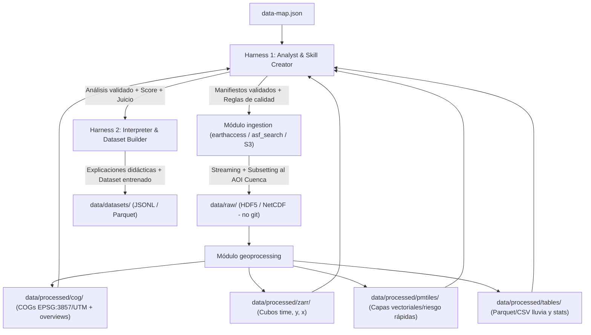

# 04 · Pipeline de Datos Reales y Arquitectura de los 2 Harnesses

Este documento detalla cómo transformamos las fuentes definidas en [`data-map.json`](../data-map.json) en productos geoespaciales rápidos (**COG + Zarr + PMTiles**) y cómo operan los **2 Harnesses** como módulos del backend Python (`compute-py`).

---

## 1. Mapa de Datos Reales (Cero Mocks)

| Fuente | Prioridad | Uso en Cochabamba | Formato de salida |
| :--- | :---: | :--- | :--- |
| **NISAR L2 GCOV** (`VALIDATED`, `PROVISIONAL`, `BETA`) | 1 (Req) | Backscatter polarimétrico (`HHHH`, `HVHV`, etc.) en dB: detección de agua/inundación (baja señal especular), humedad del suelo y pérdida vegetal. Mismo `track/frame`. | **COG** por fecha/polarización + cubo **Zarr** `(time, y, x)` |
| **NISAR L2 GUNW** (`VALIDATED`, `PROVISIONAL`, `BETA`) | 2 (Req) | Desplazamiento en línea de vista (LoS, mm) y coherencia: inestabilidad de laderas en el Tunari y subsidencia en el valle. | **COG** (desplazamiento + coherencia por par) |
| **Copernicus DEM GLO-30** | 1 (Req) | Pendiente, dirección de flujo, red de drenaje y relieve 3D en el visor. | **COG** + **terrain-RGB** + slope COG |
| **GPM IMERG Daily** (`GPM_3IMERGDF` / `GPM_3IMERGDL`) | 2 (Req) | Serie diaria de precipitación media sobre la cuenca para explicar el disparador hidrometeorológico de los cambios SAR. | **CSV/Parquet** (`tables/`) + Zarr opcional |
| **GAMC Municipal WMS** (7 servicios en `data-map.json`) | 1 (Req) | Verdad de terreno local: `Cuencas UH 7`, `Cuencas UH 8`, `Cuencas de Influencia`, `Drenaje e Influencia`, `Cota 2750`, `Limite Distritos`, `Emergencias`. | Proxy vivo WMS (`GetMap`, `GetLegendGraphic`, `GetFeatureInfo`) |
| **NISAR L3 SME2 / OPERA S1 / HLS / JRC GSW** | 3–4 (Opc) | Humedad lista para usar, histórico C-band (2016+), contexto óptico sin nubes y máscara de agua permanente (Laguna Alalay) para evitar falsos positivos. | **COG** / **PMTiles** según disponibilidad real sobre AOI |

> **Regla crítica de calidad científica:** Nunca mezclar cuantitativamente escenas `BETA` (`2025-10-17`–`2026-01-20`) con `PROVISIONAL` (`2026-06-17`–`2026-10-20`) o `VALIDATED` (`2026-10-21+`) sin etiquetar diferencias de `CRID`. Tener en cuenta el gap permanente de NISAR entre `2026-07-27T22:03:25Z` y `2026-08-10T00:55:27Z`.

---

## 2. Flujo del Pipeline Geoespacial (`COG` + `Zarr` + `PMTiles`)

### ¿Por qué combinar COG + Zarr + PMTiles?
* **COG:** Evita descargar archivos completos al navegador o al servidor de mapas; permite leer solo los tiles visibles mediante peticiones `HTTP Range`.
* **Zarr:** Organiza las adquisiciones repetidas (ciclo de 12 días de NISAR) como un arreglo multidimensional chunked `(time, y, x)`, permitiendo extraer una serie temporal de cualquier píxel o cuenca en milisegundos.
* **PMTiles:** Empaqueta capas vectoriales derivadas (polígonos de riesgo por cuenca, zonas críticas, contornos) en un único archivo estático consultable vía `HTTP Range` directamente desde MapLibre GL, sin administrar PostGIS ni servidores vectoriales adicionales.

---

## 3. Diseño de los 2 Harnesses (Módulos en `backend/compute-py/modules/`)

### Harness 1 · `harness-analyst` (Analista, Creador de Skills, Validador y Juez)
Opera como un ciclo agéntico estructurado con trazabilidad completa:
1. **Lectura y exploración de `data-map.json`:** Inspecciona las fuentes, short names (incluyendo los marcados como *verify* como `GPM_3IMERGDF`, `OPERA_L2_RTC-S1_V1`, `OPERA_L3_DSWX-S1_V1`), ventanas temporales y reglas de selección.
2. **Creación dinámica de Skills + Scripts ejecutables:** Por cada dominio de datos (p. ej. `nisar-gcov-audit`, `nisar-gunw-coherence`, `gpm-rainfall-check`, `gamc-wms-health`), genera/registra una *skill* con su especificación y **scripts Python ejecutables** para inspeccionar metadatos HDF5, verificar cobertura exacta sobre el bbox de la cuenca, comprobar consistencia `track/frame`, detectar nulos o gaps y validar la respuesta real de los endpoints WMS del GAMC.
3. **Ejecución, Scoring y Juicio (Self-Judge):**
   * Corre los scripts de sus skills sobre los manifiestos y productos reales (`data/manifests/`, `data/processed/`).
   * Calcula un **score cuantitativo** (0–100) desglosado por: cobertura espacial sobre la cuenca, continuidad temporal, consistencia geométrica (`track/frame`), nivel de madurez/calibración y completitud hidrometeorológica.
   * Emite un **reporte-juicio estructurado (JSON)** con hallazgos, anomalías físicas detectadas, advertencias metodológicas y veredicto de aptitud para alimentar al Harness 2.

### Harness 2 · `harness-interpreter` (Interpretador Didáctico y Constructor de Dataset)
Toma la salida validada y puntuada del **Harness 1** junto con las métricas reales procesadas:
1. **Traducción multi-audiencia y didáctica:** Convierte métricas técnicas (`gamma0 = -16.4 dB`, caída de coherencia InSAR, desplazamiento LoS en mm, precipitación acumulada GPM y proximidad a torrenteras/Cota 2750) en narrativas claras, visuales y accionables para distintos perfiles:
   * **Ciudadanía:** Qué significa en su barrio/distrito (zona norte vs zona sur) y qué señales observar.
   * **Técnico Municipal / Defensa Civil (GAMC):** Qué microcuenca priorizar, qué indicador SAR lo respalda y qué incertidumbre/madurez tiene el dato.
   * **Científico / Jurado NASA:** Explicación física rigurosa de la interacción de microondas banda L con agua, vegetación y terreno.
2. **Ciclo de mejora y entrenamiento/refinamiento:** Evalúa la claridad, fidelidad numérica (que ningún número contradiga el output del Harness 1) y cobertura didáctica, retroalimentando ejemplos validados (*few-shot / curated traces*) dentro del propio harness.
3. **Persistencia en Dataset (`data/datasets/`):** Guarda cada registro validado e interpretado (entrada técnica del Harness 1 + contexto territorial + salidas didácticas por audiencia + score de fidelidad) en un dataset estructurado (JSONL/Parquet), listo para ser consumido por el frontend (`didactic-insights`), auditado y reutilizado.
