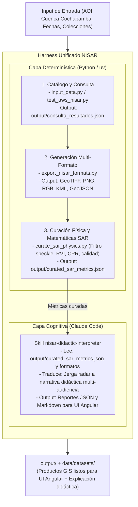

# 04 · Pipeline de Datos Reales y Arquitectura de los 2 Harnesses

Este documento detalla cómo transformamos las fuentes definidas en [`data-map.json`](../data-map.json) en productos geoespaciales rápidos (**COG + Zarr + PMTiles**) y cómo operan los **2 Harnesses** como módulos del backend Python (`compute-py`).

---

## 1. Mapa de Datos Reales (Cero Mocks)

| Fuente | Prioridad | Uso en Cochabamba | Formato de salida |
| :--- | :---: | :--- | :--- |
| **NISAR L2 GCOV** (`VALIDATED`, `PROVISIONAL`, `BETA`) | 1 (Req) | Backscatter polarimétrico (`HHHH`, `HVHV`, etc.) en dB: detección de agua/inundación (baja señal especular), humedad del suelo y pérdida vegetal. Mismo `track/frame`. | **COG** por fecha/polarización + cubo **Zarr** `(time, y, x)` |
| **NISAR L2 GUNW** (`VALIDATED`, `PROVISIONAL`, `BETA`) | 2 (Req) | Desplazamiento en línea de vista (LoS, mm) y coherencia: inestabilidad de laderas en el Tunari y subsidencia en el valle. | **COG** (desplazamiento + coherencia por par) |
| **Copernicus DEM GLO-30** | 1 (Req) | Pendiente, dirección de flujo, red de drenaje y relieve 3D en el visor. | **COG** + **terrain-RGB** + slope COG |
| **GPM IMERG Daily** (`GPM_3IMERGDF` / `GPM_3IMERGDL`) | 2 (Req) | Serie diaria de precipitación media sobre la cuenca para explicar el disparador hidrometeorológico de los cambios SAR. | **CSV/Parquet** (`tables/`) + Zarr opcional |
| **GAMC Municipal WMS** (7 servicios en `data-map.json`) | 1 (Req) | Verdad de terreno local: `Cuencas UH 7`, `Cuencas UH 8`, `Cuencas de Influencia`, `Drenaje e Influencia`, `Cota 2750`, `Limite Distritos`, `Emergencias`. | Proxy vivo WMS (`GetMap`, `GetLegendGraphic`, `GetFeatureInfo`) |
| **NISAR L3 SME2 / OPERA S1 / HLS / JRC GSW** | 3–4 (Opc) | Humedad lista para usar, histórico C-band (2016+), contexto óptico sin nubes y máscara de agua permanente (Laguna Alalay) para evitar falsos positivos. | **COG** / **PMTiles** según disponibilidad real sobre AOI |

> **Regla crítica de calidad científica:** Nunca mezclar cuantitativamente escenas `BETA` (`2025-10-17`–`2026-01-20`) con `PROVISIONAL` (`2026-06-17`–`2026-10-20`) o `VALIDATED` (`2026-10-21+`) sin etiquetar diferencias de `CRID`. Tener en cuenta el gap permanente de NISAR entre `2026-07-27T22:03:25Z` y `2026-08-10T00:55:27Z`.

---

---

## 2. Flujo del Pipeline Geoespacial y Harness Unificado

---

## 3. Diseño del Harness Unificado

Se consolida **un único Harness continuo** compuesto por:

### A. Capa Determinística (Scripts CLI en Python)
1. **Catálogo y Consulta (`input_data.py` / `test_aws_nisar.py`):** Valida credenciales AWS STS y consulta en vivo NASA CMR para listar gránulos y enlaces S3/HTTPS.
2. **Exportación Multi-Formato (`export_nisar_formats.py`):** Genera GeoTIFF (`.tif`), PNG en dB, RGB polarimétrico, KML 3D y GeoJSON.
3. **Curación Física y Matemáticas SAR (`curate_sar_physics.py`):** Suprime ruido de moteado (filtro de mediana 2D), descarta píxeles espurios, y calcula el índice de vegetación radar (RVI) y razón co/cruzada (CPR).

### B. Capa Cognitiva (Skill de Claude Code)
* **Skill `nisar-didactic-interpreter`:** Única skill agéntica de Claude Code. Recibe el JSON curado `curated_sar_metrics.json` y sintetiza explicaciones comprensibles y contextualizadas para la Cuenca de Cochabamba (Parque Tunari, Río Rocha, Laguna Alalay) orientadas a la ciudadanía, técnicos municipales y el jurado científico.
- **Función:**
  1. Abre el gránulo (local o mediante streaming remoto con `consult_s3_h5_stream.py` sin descargar gigabytes a disco).
  2. Extrae las bandas de retrodispersión (\(\gamma^0\)) calibradas y las transforma a decibeles (\(\text{dB} = 10 \cdot \log_{10}(\gamma^0)\)).
  3. Exporta los 5 productos derivados en `output/formats/`:
     * **GeoTIFF (`.tif`):** Georreferenciado en EPSG:32720 / EPSG:32719 para consumo en QGIS, ArcGIS y servicios de losetas.
     * **Visual (`.png`):** Escala de grises con barras de dB para visualización rápida en UI.
     * **Falso Color RGB (`.png`):** Composición polarimétrica (R=HH, G=HV, B=HH/HV) donde la vegetación se resalta en verde, estructuras en rojo/amarillo y agua en azul/negro.
     * **Google Earth (`.kml`):** Capa GroundOverlay con coordenadas WGS84 para vuelo 3D.
     * **Huella GeoJSON (`.geojson`):** Polígono territorial con atributos para Leaflet/Mapbox en Angular.

### Skill 3 · `nisar-didactic-interpreter` (Interpretador Didáctico con Claude)
- **Motor:** Agente Claude con prompts especializados y acceso a herramientas de cálculo/scripts auxiliares.
- **Función:**
  1. **Reconocimiento integral:** Analiza conjuntamente las estadísticas radiométricas del JSON, los porcentajes de efectos físicos (agua, suelo descubierto, vegetación y rebote doble) y las imágenes exportadas.
  2. **Traducción didáctica multi-perfil:** Transforma los decibeles y términos de ingeniería radar en información clara y comprensible:
     * **Ciudadanía:** Estado de las torrenteras, riesgo en distritos específicos y recomendaciones en lenguaje simple.
     * **Defensa Civil / Técnico Municipal:** Zonas con incremento de reflectancia húmeda, umbrales de alerta y microcuencas prioritarias.
     * **Científico / Jurado NASA:** Explicación física rigurosa de la interacción de la banda L (24 cm) con el dosel vegetal y la saturación del suelo.
  3. **Generación limpia:** Emite el reporte final pulido, estructurado y listo para alimentar la UI en Angular y guardarse en `data/datasets/` para alimentar la base de conocimiento del proyecto.

